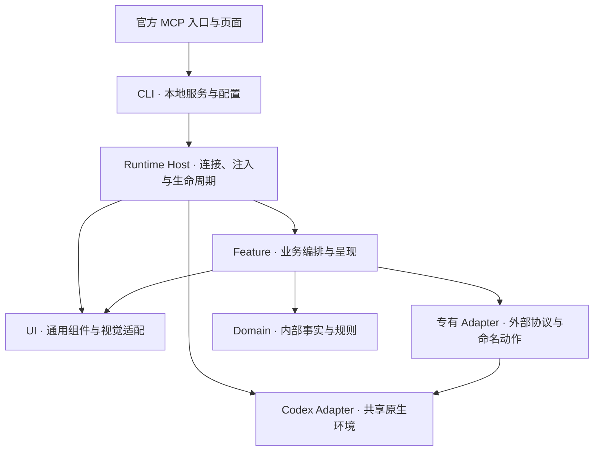

# MineCodex 架构约定

本文件负责规则所有权、依赖方向与接口选择。通用视觉和原生交互见 [DESIGN.md](DESIGN.md)，按任务读取的入口见 [AGENTS.md](AGENTS.md)。

## 柔性设计与接口原则

- **在变化发生的位置留接口。** 多个功能实际共用的能力进入共享层；外部协议变化留在 Adapter。只有一个实现且没有变化需求时，保持直接实现，避免为假设中的扩展支付维护成本。
- **接口小，内部职责完整。** 调用方只学习必要的输入、状态、结果与失败条件。模块隐藏业务口径、挂载或协议转换的复杂性；拆分以职责为依据，不以文件长度或目录对称为依据。
- **通过组合提供柔性。** 功能传内容、状态与回调，共享组件拥有通用表现。需要不同原生材质时选择明确分支，而不是让每个调用方覆盖同一套 CSS。
- **单向知识依赖。** 领域规则消费内部事实，不知道 Renderer、HTTP 服务、数据库连接或 CDP；共享 UI 不解释任何功能业务；宿主负责接线与运行。
- **外部依赖可替换，规则只有一处。** IO、时钟与原生操作通过所属 Adapter 接入，纯规则可独立验证，也可在注入工厂中复用。接口应隔离真实变化，不把每个函数都包装成策略。
- **按领域规模分层。** 有独立规则与副作用时再分领域、后端与前端；简单呈现增强保持紧凑。领域可以使用 `node:path` 等纯计算依赖，但不执行 IO。

## 所有权与依赖

图表示接入与能力流向。实际模块导入遵守单向知识依赖；Renderer 通过声明的 host action 请求后端能力，不直接取得 Node、CDP 或数据库连接。

| 所有者 | 职责与选择依据 |
| --- | --- |
| CLI | 管配置、数据迁移组合、安装与后台服务，避免页面开关承担进程管理；Windows 生命周期见 [CLI 开发约定](packages/cli/DEVELOPMENT.md)。 |
| 官方 Plugin | 管入口、离线页面资源与 MCP 通信；复用既有业务服务。面板生命周期与增强运行时独立，关闭页面不应终止增强。 |
| Runtime Host | 管发现、CDP、注入组装、可信消息、调度和运行生命周期；可导入功能后端接线，业务规则继续由功能拥有。 |
| Codex Adapter | 管多个功能真实共用的 Composer、身份、路由、React 读取与原生模块定位机制。专有 Library、模型控制器、额度和 Sites 协议留在功能 Adapter。 |
| UI | 管组件、材质、挂载角色、主题映射与视觉原生适配。组件不查询功能存储，功能不复制通用表现。 |
| Feature | 管本功能规则、存储、内容和交互；专有 Adapter 把外部对象转成内部事实与命名动作。 |

同为“图片”或“会话”的数据不自动共享业务模型。共享的依据是相同语义和实际消费需求，而不是名称相似。UI 结构与序列化接入见 [UI 架构](packages/ui/ARCHITECTURE.md)，公共环境契约见 [Codex Adapter](packages/codex-adapter/DEVELOPMENT.md)。

## 外部协议与失败

原始 DOM、React props、query cache、日志和数据库 schema 由所属 Adapter 解释。交互入口消费内部快照和命名动作，避免每次操作重新遍历 Fiber 或发现 bundle。原生动作所需的私有句柄保留在 Adapter 内，不成为领域对象。

外部协议变化时，先修正所属 Adapter 和契约样例，再核对调用方。共享机制变化才修改共享 Adapter；通用表现变化才修改 UI。原生标签和宿主 surface 接入仍由宿主维护，不能把全部原生代码机械移入共享层。

缺失能力使用明确错误或占位，身份缺失不猜当前会话。异步结果绑定实际窗口、会话、账号和挂载实例；切换或卸载后过期结果失效。清理由资源所有者维护，保留用户草稿；失败恢复依据真实契约，不用重放副作用或旧快照掩盖异常。

能力诊断由 Adapter 提供，宿主按窗口和运行会话汇总。内部诊断进入开发输出与可复制详情，普通产品界面表达可理解的状态与恢复动作。

## 注入环境

page-script 是在 Renderer 执行的函数体源码，不具有 Node 模块的 imports 和闭包。功能工厂显式序列化所需 Adapter、纯规则与前端依赖；共享 UI 由安装器组装。移动文件时同时验证序列化后的实际执行，不能只验证 Node 导入。

功能内资源经 manifest 声明，由宿主读取并随配置传入；资源路径限制在所属功能目录。这样样式与图标可独立维护，Renderer 无需另建资源请求链。具体字段与加载方式见 [Runtime Host](packages/runtime-host/DEVELOPMENT.md)。

直接注入与 iframe 保留各自真实环境：前者通过共享句柄接入原生 UI，后者通过受校验的主题与消息桥接入。浏览器控制台与官方 MCP App 共用业务和页面源码，通信适配按环境选择。来源窗口、操作白名单与鉴权由桥维护，凭据留在可信端。

## 数据迁移

CLI 组合文件格式和功能适配器，功能 backend 拥有解析、去重与合并。GUI 展示清单、预检与结果，不直接读业务文件。逐领域事务与跨功能失败的取舍由 [数据迁移契约](packages/cli/DATA-TRANSFER.md) 维护。

## 修改与验证

- 领域修改验证结果口径与关键反例；IO 修改验证路径、增量读取和错误；UI 修改验证序列化、挂载、焦点及清理。
- 静态依赖检查守住已确定的层次，不能替代行为验证。原生协议、布局与交互变化按风险在隔离窗口验收。
- 安装完成、后台健康、必要能力可用、用户操作成功和指定构建验收分别提供证据。没有适用场景不等于能力失效，全局安装标记不等于所有功能成功。
- 自检读取当前实际作用域的证据；结果保留观测时刻、窗口与会话归属。旧窗口或会话的成功记录不沿用，检查频率和汇总细节见 Runtime Host 文档。
- 文件迁移同步导入、manifest、序列化、验证与 npm 包名单，完成后移除无用途的旧实现。

完成改动前，应能说明规则所有者、涉及的外部协议、选择该接口的理由，以及证据覆盖的范围。测试清单与实现数量从当前源码查询。
