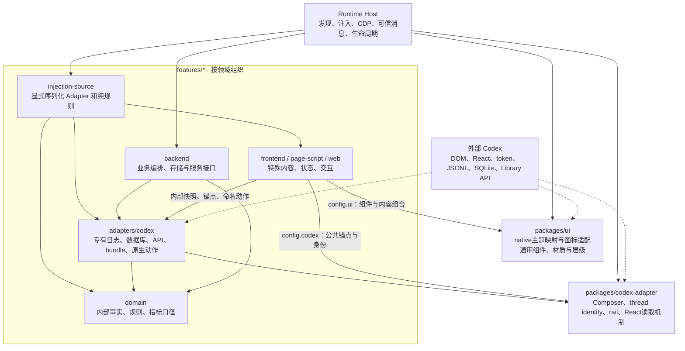

# MineCodex 架构约定

本文件负责领域归属、架构层与模块接口；通用视觉由 [DESIGN.md](DESIGN.md) 负责，内部文件导航由 [AGENTS.md](AGENTS.md) 负责。UI 结构与接入细节见 [组件库架构](packages/ui/ARCHITECTURE.md)。

## 领域与架构层

图描述能力流向，实际导入必须遵守下面的接口约束。Runtime Host 是组合入口，可以导入插件后端来接线；UI 与领域规则不反向导入宿主。前端通过已声明的 host action 请求业务，不直接使用 CDP 或本地数据库。

| 领域 | 拥有的概念与规则 | 当前代码 |
| --- | --- | --- |
| Prompts（功能 ID 保留 notes） | 提示词、分类、顺序、插入成功后的调用计数；不替用户发送消息 | `features/notes/src/backend/`、`src/frontend/` |
| Session Status | 回合、步骤、token 用量、缓存比例、体感 TPS 与上下文口径 | `features/session-status/src/domain/session-stats.mjs`、`src/adapters/codex/session-reader.mjs` |
| Images | 图片身份、Library 来源、提示词溯源、导入与查看 | `features/images/src/`，外部协议在 `src/adapters/codex/`，本地 Image Gen 编排在 `src/backend/local-image-source.mjs`，历史命令编排在 `src/backend/cloud-library.mjs` |
| Sites | 站点来源、地址分类、项目归属、收录、发现与启动 | `features/sites/src/domain/site.mjs`、`src/backend/`、`src/frontend/` |
| Model Slider | 模型身份、品牌、目录别名、真实档位、收藏与原生选择器增强 | `features/model-slider/src/domain/`、`src/frontend/`、`src/injection-source.mjs` |
| Markdown Reading | 文件 Markdown Preview 的识别、正文排版、脚注编号、原生目录衔接与恢复；不改变文档内容 | `features/markdown-reading/src/domain/`、`src/adapters/codex/`、`src/markdown-reading.mjs` |
| File Navigation | 文件路径压缩、目录分支选择；独立于文档阅读，复用原生目录与文件打开动作 | `features/file-navigation/src/domain/`、`src/adapters/codex/`、`src/frontend/` |
| 其他紧凑增强 | 各自的原生插入点与交互 | 保持本功能简单结构，不为统一外观创建空目录 |

同为“会话”或“图片”的数据，不代表不同领域共享同一业务模型。业务结果通过明确的数据对象与动作传递；共享 UI 不解释 token 用量、提示词使用次数或站点启动状态。

## 柔性设计与接口原则

- **在变化实际发生的位置留接口。** 已有多个插件使用的 Dialog、Button、Tooltip、页面层级归组件库；平台差异留在外部适配，不进入业务规则。只有一个实现且没有实际变化需求时，不预建策略类或抽象工厂。
- **模块接口小，内部职责完整。** 模块隐藏材质、挂载、序列化或业务口径的复杂性；调用方只学习必要的内容、状态、参数、结果和失败条件。不是把大文件机械拆成大量转发文件。
- **通过组合提供柔性。** Dialog 标题、内容和动作组合；原生材质按有限分支选择。插件提供回调，组件不寻找插件数据库；不采用继承树，也不接受任意 CSS 覆盖作为通用设计入口。
- **外部依赖可替换，业务事实只有一处。** 会话日志读取接受目录与时钟，事件归约不读取文件；云图片适配接受 evaluator，由宿主连接 CDP；站点服务接受 listeners/probe，由发现适配执行进程与网页探测。
- **单向知识依赖。** `domain` 不知道 Renderer、HTTP 服务、数据库连接或 CDP；UI 不知道任何功能领域；宿主负责组合，不拥有提示词、图片或会话指标规则。
- **显式失败和生命周期。** 缺失原生能力返回已有错误/占位，不猜身份或展示旧会话数据。异步结果归属、卸载和用户草稿由真实所有者维护；不以过度防御掩盖失效契约。
- **按领域规模分层。** 简单插件保留一个入口；有独立规则和副作用时再分 `domain` / `backend` / `frontend`。领域规则不强求零依赖，例如项目目录匹配可以使用 `node:path`，但不得执行 IO。

## 注入与资源契约

当前 page-script 仍是函数体源码，由 Runtime Host 执行并接收 `signal` 与 `config`；不是可以在 Renderer 直接 imports 的 Node 模块。`packages/ui/src/install.mjs` 将组件安装函数显式组装成自包含源码，宿主不复制组件实现。

较大的前端入口可在 manifest 的 `entry.resources` 中声明 CSS、图标 JSON 等资源文件：键映射到本功能内相对路径；JSON 解析为数据，其他文件读取为文本，经 `config.resources` 一次传入。资源不可越出功能目录，不新增 HTTP 请求或前端打包步骤。Prompts 与 Sites 使用这一接口把样式、图标和交互源码分开。

需要将纯规则组装进注入源码时，插件可声明 `entry.sourceFactory`，指向本功能内导出 `createPageScriptSource()` 的 Node 模块。宿主只调用工厂取得函数体源码；工厂负责把专有 Adapter 和纯规则序列化进去，Renderer 不依赖 Node imports。Images 的 Library 面板与历史云导入共用 `src/domain/library-prompt.mjs`。

Images 的 iframe 仍使用主题/消息桥；原生 Library 增强仍使用 Renderer 入口。两种接入不强行合并。

## 修改与验证

修改领域规则时验证结果口径；修改 IO 适配时验证路径、增量读取和错误；修改共享 UI 时验证安装源码、角色选择、焦点和卸载。原生布局、材质与交互按风险在隔离窗口验收。静态依赖检查只用于防止已确定的架构层反向导入，不取代行为验证。

文件迁移同时更新 imports、manifest、命令、验证及 npm files。删除原位置文件，不保留转发兼容壳。公开 README 维护产品与使用说明；内部路由回写 AGENTS，通用视觉回写根 DESIGN，本级规则回写本级文档。

Model Slider 的领域规则与原生控制器适配归插件，`src/injection-source.mjs` 显式组装两者；宿主只提供 feature 配置、共享 UI、图标工厂、locale 与刷新调度，调用 `ensure` / `dispose`。原生 React 操作仍由插件适配层维护，领域规则不读取 DOM 或 localStorage。旧 Summary 布局属于宿主 surface 接入，仍保留在 `codex-injection.mjs`。

架构验证自动发现所有插件的 domain 目录，检查静态导入、再导出、动态模块依赖和外部环境引用；同时检查已注册 Renderer 入口及 frontend 的反向依赖，以及启用插件的 Tooltip 材质归属。纯规则的模块导入和自包含序列化行为由所属插件测试覆盖，不以测试数量替代领域归属审查。

## Codex 防腐层职责（2026-10-01）

- `packages/codex-adapter/src/renderer/environment.mjs` 只拥有真实共享的原生读取机制与锚点。`composer()` 默认返回可见 thread 输入框的 root/body/add 与身份；Prompts 使用 `purpose:"insertion"` 读取可见的 Codex／ChatGPT 原生输入框，包含首页、浮动聊天和面板 chat bar；插入操作绑定打开面板的 editable，非thread不提供身份。缺失身份立即返回 null。`railSlot()` 返回扩展挂载句柄。`currentFiber()` / `props()` 仅供 native Adapter 使用，不向业务层传递 React props。
- `packages/ui/src/native/` 拥有视觉协议。`tokens.mjs` 的规范名称和别名解析到 `--mcx-*`；`theme.mjs` 处理主题读取、直接注入变量、桥接快照和卸载恢复。原生 token 改名时加别名，保留项目规范名称和输出 token；插件不复制原生兼容映射。
- `features/<id>/src/adapters/codex/` 拥有专有语义转换。Session Status 的日志转为 `kind/at` 事实和 `input/cached/output/total` 用量；Images 将原始树转换为生成事实，再由领域选择提示词。SitesCatalog 返回内部 projects/threads；Usage 返回额度快照，不暴露 queryClient/auth/router。
- Model Slider 暴露明确字段的控制器视图和选择/菜单动作，不返回整个 React props；档位对象作为原生选择动作的句柄保留在该接口内，不进入模型领域规则。Task Switcher 从原生目录输出线程展示记录及 activate 回调；通知状态事件、去重与关闭记录归本功能 domain，前端维护通知堆栈。
- 能力诊断由 Adapter 维护。Renderer 可通过运行时 `nativeCapabilities()` 查看 name/available/reason；目录 Adapter 提供 `diagnostics()`。未知状态不伪装成已读或闲置；用户界面不展示技术诊断。

不要把原生相关代码一律移到共享层：Library、模型控制器、账号额度、Sites 路由和数据库属于专有 Adapter。简单 Banner 本身是一个呈现 Adapter，无业务领域，不新增空 domain/backend 目录。宿主的原生标签、surface 接入仍属于注入与生命周期边界；通用视觉与插件业务不回流到宿主。

契约验证覆盖内部事实、当前 React alternate、隐藏输入框、账号切换、订阅清理、bundle 失效重试、主题消失/恢复和九插件源码组装。架构检查同时阻止 domain 重新解析已隔离的外部 schema，以及交互入口重新发现 React/query cache/bundle API。

## 注入自检契约（2026-10-03）

安装证据、后台服务健康、必要原生能力、用户操作结果与构建验收分别记录。功能定义必要锚点和适用场景，UI 主题 Adapter 负责实际作用域的 token 读取，Runtime Host 负责每个文档完成注入后的一次观测、窗口与 session 归属、重载／重连后的重检、失效清理及汇总；不持续轮询锚点和 token。domain 不解释 DOM、CSS 或原始自检协议。

`selfCheck()` 仅确认当前可观测条件，不将缺少场景误报为不兼容，也不将全局脚本安装成功当成逐功能成功。静态源码消费清单用于定位 token，实际可用性必须读取当前计算样式。已知 CSS fallback 的缺失项仍记录；无 fallback 的必需值缺失或作用域映射不一致标为 degraded。用户操作和完整构建验收仍有独立证据边界。
