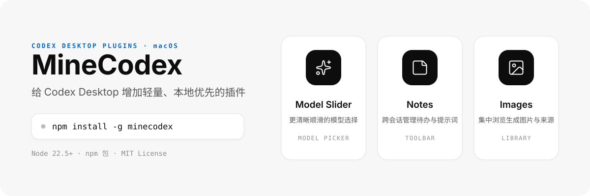

<p align="center">
  
</p>

# MineCodex

MineCodex 给 Codex Desktop 增加一组轻量、本地优先的扩展功能。所有数据均保存在本地，不经过任何第三方服务器，也不会改变 Codex 的原有使用习惯。

## 插件列表

| 插件 | 说明 |
| --- | --- |
| **Model Slider** | 更清晰、更顺滑的模型切换面板：具备品牌标识、常用收藏与流畅交互 |
| **Prompts** | 专页分类管理提示词与调用统计，输入框 Quick Prompts 快速调用 |
| **Usage Meter** | 在 Help 与 Account 之间显示剩余额度环，悬浮查看周 / 五小时额度，点击进入 Usage 设置 |
| **Images** | 在原生 Library 图片详情中查看并复制提示词 |
| **Hide Upsell Banner** | 隐藏输入框上方的用量提示横幅，仅优化界面展示，不影响正常的用量统计 |
| **Session Status** | 在输入框下方查看当前任务的步骤、观测速度、Token 用量与上下文明细 |
| **Unread Chats** | 侧栏收起时悬停标题栏铃铛，查看并切换原生未读会话 |

## 安装

MineCodex 支持 macOS 与 Windows 系统，需要 Node.js 22.5 或更高版本。安装程序会自动扫描 `/Applications/ChatGPT.app` 或 `~/Applications/ChatGPT.app` 寻找 Codex Desktop；在 Windows 上则通过 MSIX 包（`OpenAI.Codex`）定位官方 ChatGPT 应用并校验 OpenAI 签名。如果均未找到，安装将暂停并给出说明。

```bash
npm install -g minecodex
mcx install
```

运行 `mcx install` 不会强制关闭或启动 Codex，也不会影响当前打开的窗口。安装完成后，终端会说明更改将在下一次重启 Codex 时生效，并询问是否立即重启；默认选项为 **No**。只有在您明确确认，或后续手动运行 `mcx restart` 时，才会重新打开 Codex。安装完成后，macOS 的“登录项与扩展”中会添加名为 **MineCodex** 的后台项目。

`mcx install`、`mcx update`、`mcx restart` 和 `mcx uninstall` 会在终端持续显示当前阶段；`mcx open` 仅在需要启动后台服务时显示进度。查询类命令保持简洁，便于直接阅读或用于脚本。

MineCodex 只以后台辅助服务运行，前台应用始终是 OpenAI 签名的官方 ChatGPT 应用，并继续使用官方默认用户数据。通过 Dock、Finder、Spotlight、登录项或会话恢复打开 ChatGPT 时，后台服务会验证官方应用与对应进程；若该进程尚未开放兼容的本机调试端口，则确认其完整退出后再重新打开官方应用并注入功能。MineCodex 不修改官方应用文件、`app.asar`、Dock 项目或默认打开方式。在 macOS 上，后台项目出现在"登录项与扩展"中；在 Windows 上，后台任务出现在任务计划程序（任务名 `MineCodex`）。

打开本地控制台：

```bash
mcx open
```

常用命令：

| 命令 | 作用 |
| --- | --- |
| `mcx install` | 安装或修复 MineCodex |
| `mcx uninstall [--purge]` | 移除扩展；默认保留个人数据，带 `--purge` 参数才会清理 |
| `mcx update` | 更新到最新的稳定版本 |
| `mcx open` | 打开 MineCodex 控制台 |
| `mcx status [--json]` | 查看安装与插件运行状态 |
| `mcx restart` | 重启 Codex 并应用插件开启/关闭状态 |

关闭某项功能仅停用对应的扩展服务，不会删除任何个人数据；修改设置后运行 `mcx restart` 即可应用更改。

运行 `mcx uninstall` 会移除名为 MineCodex 的后台项目，并默认保留配置设置、Notes 笔记和 Images 图片索引；只有显式加上 `--purge` 参数，才会清理 MineCodex 产生的本地配置。MineCodex 绝不会删除 `~/.codex/generated_images` 中的原始图片或 Notes 引用的本地文件。

## 工作原理

MineCodex 统一管理 Codex 内的菜单入口、主题风格与界面适配。Model Slider、Prompts 各自管理操作界面，Images 增强原生 Library 的提示词查看；Session Status 只读汇总本机 Codex 会话事件，Hide Upsell Banner 优化界面展示。所有功能按需开启，关闭后即停止运行。

## 开发

```bash
npm install
npm test
npm run check
npm run pack:check
npm run pack:audit
```

## 许可

MineCodex 是非官方独立扩展项目，与 OpenAI 无关联。项目自有代码以 MIT License 授权；第三方图标、品牌和兼容资产遵循各自的权利说明，见 [`features/model-slider/THIRD_PARTY_NOTICES.md`](features/model-slider/THIRD_PARTY_NOTICES.md) 与 [`features/session-status/vendor/lucide-LICENSE`](features/session-status/vendor/lucide-LICENSE)。
