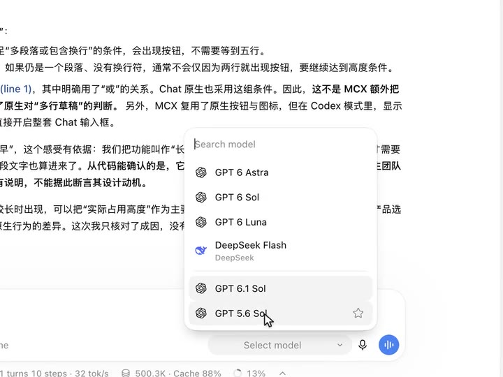
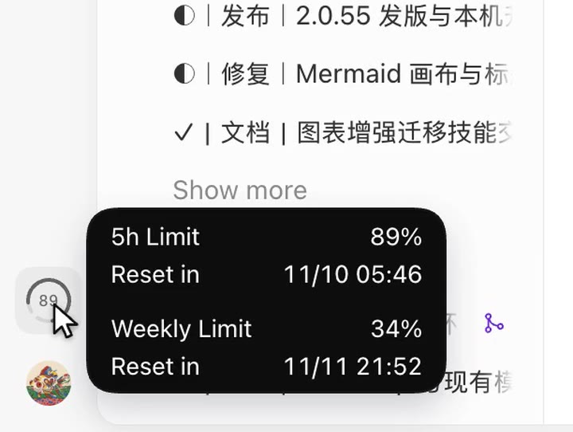
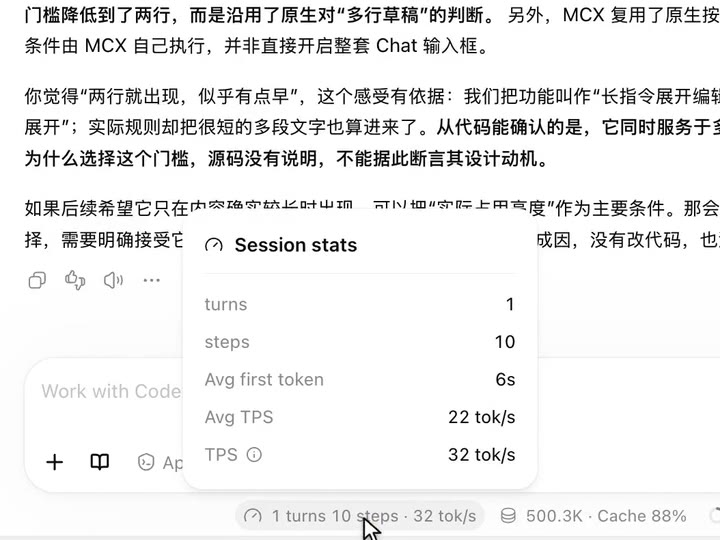
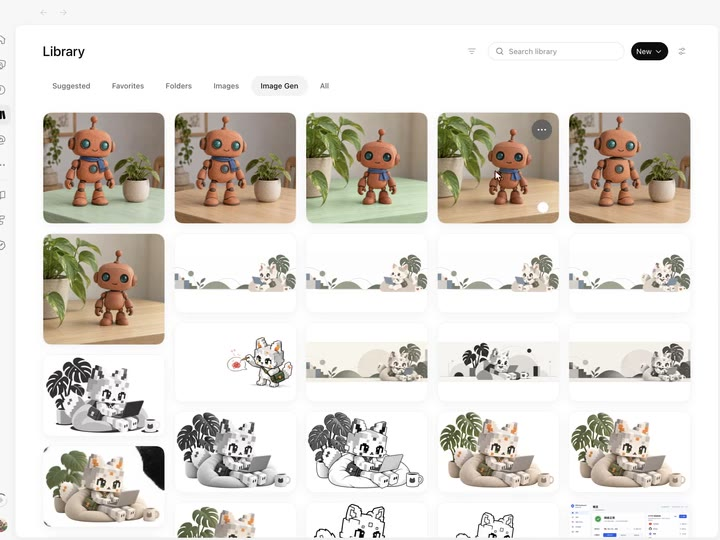

<p align="center">
  <picture>
    <source media="(prefers-color-scheme: dark)" srcset="./assets/readme/hero-dark.svg">
    
  </picture>
</p>

<p align="center">
  <a href="#安装">安装</a> ·
  <a href="#13-项增强">全部功能</a> ·
  <a href="#它如何工作">工作方式与隐私</a> ·
  <a href="#常见问题">常见问题</a>
</p>

**MineCodex 是一个给 Codex Desktop 用的增强工具箱。** 它在你熟悉的 Codex 界面里补上一些顺手的小功能：更快地切换模型、一键填入常用提示词、随时看到剩余额度、更舒服地阅读长文档和图表。每一项都可以单独开关，外观沿用 Codex 原生风格，看起来就像 Codex 本来就有。

<table>
  <tr>
    <td width="50%"></td>
    <td width="50%"></td>
  </tr>
  <tr>
    <td><b>模型窗口</b> · 在输入框旁选模型和思考档位，常用模型可收藏</td>
    <td><b>额度环</b> · 不打开菜单，也能看到五小时和每周额度</td>
  </tr>
  <tr>
    <td></td>
    <td></td>
  </tr>
  <tr>
    <td><b>会话状态</b> · 当前会话的用量、上下文和生成速度集中在一处</td>
    <td><b>图片集合</b> · 浏览生成过的图片，随时找回当时的提示词</td>
  </tr>
</table>

## 13 项增强

全部功能都可以在控制台单独开关。控制台里每一项都配有真实录屏，可以先看效果再决定是否开启。

| 场景 | 功能 | 它帮你解决什么 |
| --- | --- | --- |
| 选模型与提示词 | **模型窗口** | 模型和思考档位放在一起选，常用模型可搜索、可收藏。 |
| | **提示词库** | 按分类管理常用提示词，一键填入输入框；不会自动发送，由你检查后再发。 |
| 掌握用量 | **额度环** | 侧栏常驻五小时与每周剩余额度，点击查看用量详情。 |
| | **会话状态** | 当前会话的 Token 用量、上下文占用和回复速度集中显示。 |
| 阅读文档与图表 | **Markdown 阅读增强** | 长文排版更舒服，支持章节目录、脚注跳转、表格展开和代码复制。 |
| | **Mermaid 图表增强** | 复杂图表布局更清楚，可缩放、可下载 PNG；关闭后恢复原生图表。 |
| 浏览项目文件 | **文件级联浏览** | 点击文件路径，分列浏览相邻目录并切换文件。 |
| | **Files 自动刷新** | Agent 新增、删除或重命名文件后，Files 列表自动更新，保留浏览位置。 |
| 管理素材与网页 | **图片集合** | 浏览本机生成的图片，查看对应提示词，收藏到 Library。 |
| | **站点收藏** | 自动发现正在运行的本地项目网页，收藏常用网址并快速打开。 |
| 写作与提问 | **长指令展开编辑** | 写长指令时展开成大尺寸输入框，收起后草稿保持不变。 |
| | **快捷聊天增强** | 恢复 Quick Chat 快捷键，发送后自动展开，支持历史与窗口固定。 |
| 整理界面 | **侧栏聚焦** | 一键收起其他任务分组，只看当前分组；再点一次恢复原样。 |

## 安装

**准备：** macOS 或 Windows，已安装 Codex Desktop 和 [Node.js](https://nodejs.org/) 22.5 或更高版本。

在终端依次运行：

```bash
npm install -g minecodex
mcx install
mcx open
```

`mcx install` 会安装后台服务，完成后询问是否立即重启 Codex；重启后增强即生效。`mcx open` 会在浏览器中打开控制台，你可以在这里按需开关功能，修改后运行 `mcx restart` 应用设置。

<details>
<summary><b>可选：在 Codex 里直接打开控制台和 Prompt 页面</b></summary>

<br>

1. 先安装 [Codex CLI](https://developers.openai.com/codex/cli/)，再运行：

   ```bash
   mcx plugin install
   ```

2. 在 Codex 的插件页点击刷新，从 Explore／探索找到 MineCodex 和 Prompt。
3. 需要常驻侧边栏时，分别点击它们旁边的“固定到侧边栏”。

</details>

### 常用命令

| 命令 | 作用 |
| --- | --- |
| `mcx open` | 打开控制台 |
| `mcx restart` | 重启 Codex 并应用设置 |
| `mcx status` | 查看安装与运行状态 |
| `mcx update` | 更新到最新稳定版 |
| `mcx uninstall` | 卸载，保留个人数据；加 `--purge` 同时删除数据 |

## 它如何工作

MineCodex 在本机运行一个后台服务。它让 Codex 以只对本机开放（`127.0.0.1`）的调试端口启动，并在运行时把增强加载进 Codex 窗口。

- **不修改 Codex 安装文件。** 卸载 MineCodex 后重新打开 Codex，就是原本的样子。
- **数据留在本机。** 提示词、收藏和设置保存在你的电脑上；除了检查新版本时访问 npm，MineCodex 不上传任何内容。
- **单项失效不影响整体。** 某个增强出问题时，Codex 和其他增强照常运行。

## 常见问题

**Codex 更新后某个增强不见了？**
MineCodex 依赖 Codex 的界面结构。Codex 改版后，个别增强可能暂时失效。先运行 `mcx update` 获取最新版本，再运行 `mcx restart`；问题仍在时，可以在控制台页尾复制诊断信息并[提交 Issue](https://github.com/Vontean/MineCodex/issues)。

**会影响我正在进行的会话吗？**
`mcx restart`（以及安装结束时你确认的重启）会重启 Codex。建议在没有正在运行的任务时操作。

**这是 OpenAI 官方产品吗？**
不是。MineCodex 是非官方的独立项目，与 OpenAI 无关联。

## 许可

[MIT](LICENSE)。第三方素材遵循各自的[权利说明](features/model-slider/THIRD_PARTY_NOTICES.md)。
