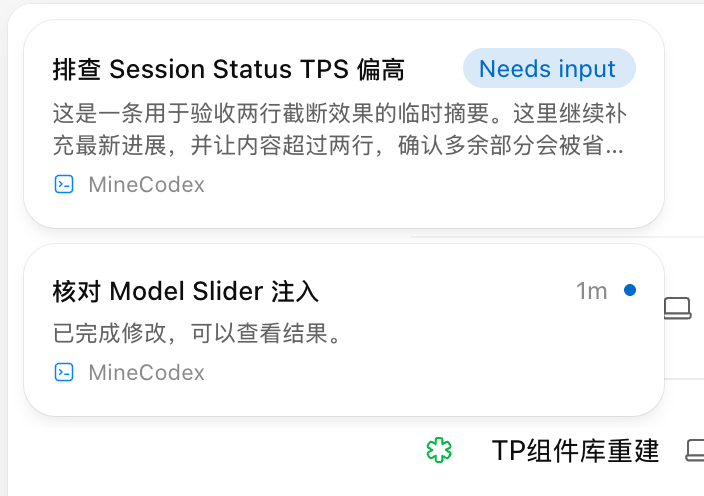

# Task Switcher 通知形态验收

日期：2026-10-03。Codex 26.930.21537，隔离 profile `/Users/mac/.codex-model-slider/codex-profile`、CDP 9233。未更新日常安装，未提交、发布或重启应用。

## 源码与自动验证

- 移除标题／Tab 入口、悬浮热区、Sidebar 图标替换和 Activity 自动切换。
- 会话通知只包含需要回复、等待批准、已结束未读；Loading 不通知。
- 新事件置顶，同一 Chat 去重；当前、已读／已解决、目录删除、再次运行自动移除。关闭只影响本窗口，不修改原生读状态。
- 复用原生目录、状态 selector、项目归属和导航，侧栏只挂载7行时能读取72条目录记录。未取得原生数据时隐藏并报告能力不可用。
- 全项目409项测试通过，174个JS文件语法检查通过。

## 隔离 Renderer

- Space／Projects 中会话侧栏不可见时可显示；Home 常驻会话侧栏展开时隐藏。
- 原生 Home 悬浮侧栏展开时布局报告暂停显示，通知容器 hidden=true；通知层低于原生侧栏。
- 一次真实通知卡片点击复用原生导航，目标 `local:01a0fb77-915c-7ce2-841d-2f47ebc61358` 与导航后 Composer 会话身份一致。未发送消息或执行批准。
- 受控状态样例验证两个标签、已结束未读、Loading 排除、新批准状态置顶和时间右侧蓝点。样例只替换隔离预览的通知快照，原生会话状态未修改。
- Padding 初始实测为左14px、右30px；右侧额外空间来自插件为关闭按钮预留，并非原生祖先。曾按原生会话条目局部 token 实测上右下5px、左8px，但用户认为过于拥挤；最终按确认结果采用功能 token `--mcx-notification-padding:14px`，四周一致。
- 摘要 `line-clamp:2`：长样例实测高32px、行高16px；短摘要高16px。截图仅展示受控样例，非真实待回复事件。

## 证据边界

当前隔离原生目录无命中的真实待处理会话；未主动制造真实批准、用户输入请求或未读消息。真实事件从产生到通知出现仍需要实际会话触发验收。截图与受控状态只证明通知呈现、过滤、顺序和导航接线，不替代该证据。

为使被遮挡隔离窗口的原生 hover 动画正常完成，最后的交互检查临时启用 CDP focus emulation；结束后恢复。临时通知样例清除，隔离预览回到真实原生状态。

## 倒计时与堆栈动效追加验证

- 当前原生 app-initial 的 localTaskRow：Needs input 从匹配的 userInput pendingRequest 与 requestUserInputAutoResolution scheduled 状态读取 deadlineMs，原生进度时长为60000ms；Awaiting approval 只提供 chip，没有倒计时。Adapter 动态解析角色及进度常量，不固定压缩符号。
- 隔离9233成功读取72条真实原生目录，再覆盖8条受控通知用于交互验证。倒计时数字更新前后卡片、标签保持同一 DOM；模拟恢复 Working 后退出动画完成，节点移除。
- 同一 CDP 会话启用 focus emulation 后测得被推移通知 y=52 → 146.76（100ms）→ 164（完成），非瞬移；不将被系统遮挡窗口的动画节流当作前台表现。
- 八条样例下可视高度509px；第六条 top=476、height=66，可见33px，恰好半条。底部渐隐33px，滚动到底后 mask=none。
- 本次验证证明原生读取契约及受控状态转换；未制造真实审批或自动处理请求，真实事件端到端仍需自然发生。

## 窗口可用高度与剩余条目提示（取代五条限制）

- 堆栈使用窗口剩余高度，不再按第五条计算上限；底部仍按边缘卡片半高计算渐隐。
- 渐隐区中央增加独立文字层，统计部分进入遮罩及下方未显示的条目；随滚动更新，到底隐藏文字和遮罩。
- 隔离窗口15条模拟通知实测：窗口高1122px，堆栈高1058px；顶部显示4 more activities，滚动200px后显示2 more activities，到底隐藏。文字中心1082.5px与渐隐区中心一致。

## 默认三条折叠堆栈（取代直接全部展开）

- 默认仅呈现前三条，第三条下方露出两层缩进边缘；按钮显示总数减三的 more notifications。展开后使用窗口剩余高度，仅在溢出时渐隐，不显示遮挡数量。
- 隔离窗口15条样例：初始3条及12 more notifications；关闭一条后自动补位，仍3条且变为11；点击展开后14条，装饰和按钮隐藏；溢出存在渐隐，滚动到底后解除。
- 展开状态保留到通知清空、账号变化或重新加载；倒计时与状态移除沿用已有行为。

## 页面跳转重置展开状态

- 从原生 React routeContext 读取内存路由 pathname；不依赖始终为 app://-/index.html 的 window.location。
- 跳转后恢复三条并清零滚动，使用320ms高度缓出和卡片淡出；同页刷新不收起。
- 隔离窗口实际点击通知完成会话跳转：路由改变、卡片从15条回到3条，面板高度1058 → 370（过渡中）→ 288px，按钮恢复、scrollTop=0。同页 sync 保持展开。19项相关测试及语法检查通过。
