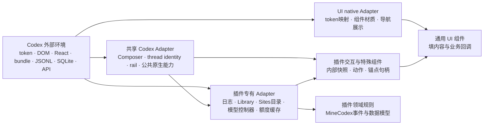

# Codex 外部防腐层审查

日期：2026-10-01。源码基线：4e8a443。范围：九个注册插件、UI 组件库、Runtime Host、被维护的 Images 历史云导入。仅检查源码、接口归属与现有验证范围；未访问运行中的 Codex 或执行窗口操作。

当前状态：本轮代码迁移及源码契约验收已完成，见末尾“迁移后的源码验收”；以下保留修复前的原始审查证据。

## 初次审查结论与成功标准

**部分建立，未达到完整防腐层的验收标准。** 共享 UI 与业务归属改善了，但“代码放进 domain / frontend / backend”不代表已隔离外部协议。

可检查的标准：

1. Codex token、选择器、路由、React props、资源发现、日志及数据库 schema 的知识归属明确的 Adapter；同一外部契约不在多个插件复制。
2. 插件交互和领域规则消费 MineCodex 定义的结果与能力，不解析外部原始对象或接收原生 queryClient/router/controller。
3. Codex 改名或修改结构时，变化集中于所属 Adapter 与其契约样例，领域统计、提示词选择、列表排序等规则不需跟改。
4. 能力不可用有明确结果与内部诊断；未知／不可用不伪装成零、false或合法空列表。正常用户界面仍保持简洁。
5. Adapter 验证包含外部输入到内部结果的转换、缺失字段、能力变化与清理，而非只证明无 Node import / IO。

## 已经建立的隔离

- `packages/ui/src/native/tokens.mjs:7` 集中 token 名单与已知别名；宿主 `codex-injection.mjs:691` 解析主题并供 iframe 消费。
- UI 外壳统一维护 Dialog、Button、Tooltip、Page 等材质，插件无需复制这些外部规则。
- `packages/ui/src/native/navigation-rail.mjs:2` 将原生 React 导航项、IconAsset 和 DOM 图标工厂的读取与 NavigationRail 展示分开，是当前较清晰的 Adapter 实例。
- Host action 的权限与传输集中于 Runtime Host；Images 云路径接受 evaluator；SessionStatusReader 接受目录与时钟；Sites 外部探测接受 listeners/probe。它们提供了接入 seam，但有些仍没有完成原始数据转换。

## 初次审查发现（4e8a443 基线，路径和行号为历史证据）

### ACL-01：领域直接依赖外部 schema（P1）

`features/session-status/src/domain/session-stats.mjs:95` 直接处理 Codex 的 event_msg、response_item、token_usage_record、payload.info.total_token_usage 等原始日志结构。Reader 解析 JSON 后直接调用领域归约器。

`features/images/src/domain/library-prompt.mjs:2` 直接读取 conversation.mapping、origination_message_id、image_asset_pointer、metadata.dalle 等 ChatGPT 协议。

这不是 IO 越界，但外部 schema 已成为领域 Interface。改日志或图片元数据就需修改 domain。应先转换为内部会话事件、统一 token 用量、图片生成事实及请求来源，再由领域规则计算指标／决定提示词优先级。不要只把原始字段改成 camelCase 就称为完成转换；还需确定事件含义、未知数据与时间口径。

### ACL-02：公共原生能力在多插件重复探测（P1）

Prompts `src/frontend/entry.mjs:225,1245` 直接定位 Composer 与 rail/固定扩展区；Session Status `src/session-status.mjs:409`、Task Switcher `src/unread-inbox.mjs:109`、Sidebar Focus `src/sidebar-focus.mjs:32` 重复读取当前 thread 标记。多个插件自己遍历 React Fiber 获取上下文。

Model Slider `src/frontend/install.mjs:336` 已处理 current/alternate Fiber；其他读取器使用自己的遍历规则。新版 React 或 Composer 结构变化会扩散到多个文件，并可能产生当前会话身份不一致。

应集中真正共享的 Composer、当前 thread、rail 与 React 读取能力，提供小型 Interface；不要把所有选择器搬进一个巨大常量表后让插件继续自行解释原生对象。

### ACL-03：专有原生 Adapter 与交互混在一起（P2）

Sites `src/frontend/entry.mjs:18–75` 同时拥有 /space/sites、搜索占位文案、React props、列表子节点位置与 CSS 类缓存。Model Slider 的资源发现、controller 提取、选择动作与增强 UI 混在同一 frontend/install.mjs。Usage Meter `src/usage-meter.mjs:22–48` 直接读取 auth、queryClient、rate-limit-status 与账号字段。Task Switcher／Sidebar Focus 也直接读取内部 props。

这些能力具有插件专有含义，不宜全部搬到 UI。应在插件内部建立明确的 native Adapter，给交互层返回页面锚点、规范化快照与动作 Interface，隐藏 router/queryClient/React props。简单 Banner 插件本身就是紧凑的原生呈现 Adapter，无须为了整齐机械拆目录。

### ACL-04：主题别名仅覆盖部分消费路径（P2）

共享 token 注册表与别名已经存在，但 `codex-injection.mjs:691–707` 主要在读取主题／发送桥接数据时解析；直接注入的插件 CSS 与共享组件仍使用原生 CSS token 名称，未统一消费同一份稳定的 MineCodex 主题契约。

原生 token 在 UI 的 native/Foundation 实现里出现是合理的；问题是插件特殊样式与 iframe／直接注入路径仍需分别适配改名。应由 UI 主题 Adapter 将所需原生语义解析到稳定的项目 token，保留原生名称与来源文档，并让两条路径共用解析结果。按已使用的语义维护有限映射，不预建完整 token 框架。

### ACL-05：数据与资源协议的归属尚不完整（P2）

SitesService.catalog `src/backend/sites-service.mjs:22` 在业务服务中直接读取 .codex-global-state.json、local-projects、projectless-thread-ids、state_5.sqlite 和 threads 表，应由目录 Adapter 提供内部 projects/threads 快照。

Images 当前 Library 前端 `src/library-prompt-page.mjs:25` 与历史云路径 `src/backend/cloud-library.mjs:12` 各自解析 metadata 资源、压缩符号和初始化导出。溯源业务已共用，但资源发现／API 发现仍存在两份外部协议知识。保留历史路径时应共用发现 Adapter，再分别实现 viewer 与下载的专有能力。

Session Status `src/session-status.mjs:472` 的原生上下文 atom 发现也依赖当前 bundle 的源码模式，应归本功能原生 Adapter，不由呈现层解析。

### ACL-06：现有验收未覆盖协议泄漏与失效可观测性（P2）

`packages/ui/test/module-boundaries.test.mjs:65–107` 检查领域 IO／导入方向和前端反向导入，不会发现 domain 读取原始外部 schema，也允许原生资源动态导入。测试通过不能据此宣称完整防腐层通过。

部分原生解析失败只返回 null、false或保持占位，例如 Session Status 上下文发现 catch；这样 UI 不显示旧数据是正确的，但内部缺少统一的能力状态与失效原因。应在 Adapter 层返回或记录契约名、可用状态、失效原因与必要的构建信息，并在开发诊断中查看；不要把这些技术详情塞进正常产品 UI。

## 初次审查九插件结果

| 插件 | 防腐层结果 | 实际缺口 |
| --- | --- | --- |
| Prompts | 部分 | 导航展示已调用共享组件；Composer、rail挂载与布局探测仍在交互入口 |
| Session Status | 未完成 | 原始日志 schema 进入 domain；原生 scope/atom/bundle 发现混在呈现层 |
| Images | 未完成 | 原始 conversation/file schema 进入 domain；两条路径重复资源/API发现 |
| Sites | 未完成 | 原生页面探测混在交互层；Codex JSON/SQLite契约混在业务服务 |
| Model Slider | 部分 | 领域规则独立，但专有原生 controller、资源与呈现尚未拆开 |
| Usage Meter | 部分 | 原生缓存与 auth 读取有局部函数，但没有独立快照 Interface |
| Task Switcher | 部分 | 原生 props、thread身份与列表策略混合 |
| Sidebar Focus | 部分 | 聚焦逻辑与原生 props/当前 thread 探测混合 |
| Hide Upsell Banner | 小型原生 Adapter 可保留 | 文案/aside识别是实际外部契约；明确归属与契约验证即可，不强拆层 |

## 初次审查建议结构与顺序

候选目录为 `packages/codex-adapter/src/renderer/` 与 `src/node/`（共享宿主能力）、现有 `packages/ui/src/native/`（UI主题与视觉适配）、`features/<id>/src/adapters/codex/`（专有协议）。这是拟议结构，当前尚未创建。按能力划分，不建“CodexGateway”万能对象；Node 与 Renderer 源码必须继续分别组装，不能让 Renderer import Node。

执行顺序：先迁移共享身份／Composer／rail，减少跨插件错误；再拆 Session Status 和 Images 的协议转换；随后提取 Sites目录与各专有 Adapter；最后统一主题消费并补协议契约验证与开发诊断。每个能力迁移都包含所属调用方与测试，不以先搬文件、保留旧入口转发作为完成。

初次审查没有进行功能迁移。下文为之后按用户授权执行的实际修复；本节的发现、路径和行号作为原始审查证据保留，不再表示当前源码。

## 迁移后的源码验收（2026-10-01）

本轮按职责完成上述六项问题的迁移。当前架构以根 ARCHITECTURE.md、AGENTS.md 与实际源码为准。此前“部分建立”的结论属于修复前基线；本轮源码和契约验证通过，不代表原生窗口视觉验收。

| 问题 | 实际修复 | 验证 |
| --- | --- | --- |
| ACL-01 | SessionStatus 日志转为内部事件/用量，domain 只归约内部事实；Images 原始树在 image-prompt Adapter 转换，domain 仅决定生成提示词/原始请求优先级 | 原始日志回归、事实契约、未知记录、生成来源与真实序列化路径 |
| ACL-02 | 新增共享 Codex Renderer environment；Composer、thread identity、rail/扩展槽、React current/alternate 机制复用 | 隐藏/非thread输入框、身份清空、ancestor scope、alternate、全插件工厂组装 |
| ACL-03 | 模型控制器/资源、Usage auth/cache、Task线程记录、Focus分支、Sites页面/路由/模板移到专有 Adapter；交互入口不再解析原生 props/query cache | 原生选择行为、账号切换、线程卸载后的 activate、订阅清理、静态边界 |
| ACL-04 | UI theme Adapter 统一原生规范名称/别名与 `--mcx-*`；直接注入和 iframe 使用同一快照；插件自有 CSS 消费项目变量 | 别名优先级、缺失token清除、卸载恢复、原生材质分支与组件回归 |
| ACL-05 | Sites CodexCatalog 封装 JSON/SQLite；Images Library API 发现只有一份，viewer/历史导入消费命名操作；日志Reader归专有 Adapter | 目录业务回归、API复用/失效重试、无client泄露、真实工厂组装 |
| ACL-06 | 架构检查增加 domain schema 与 Renderer私有协议限制；共享机制、日志转换、Library与主题补契约样例；运行时提供内部能力诊断 | 全量测试、语法、发布包审查；内部诊断不进入产品界面 |

九插件归属已核对：Prompts 消费共享环境与 UI；Session Status、Images、Sites、Model Slider、Usage Meter、Task Switcher、Sidebar Focus 使用领域专有 Adapter；Hide Upsell Banner 保留紧凑呈现 Adapter，不增加空业务层。Model Slider 的控制器视图是有限字段与动作接口，power selection 为其专有动作句柄；不向领域规则传递整个原生 props。

当前公开文档不承担内部文件路由；根 AGENTS 维护入口，根 DESIGN 维护通用规范，本级 DESIGN 只描述特殊表现。发布包已包含新 Adapter 和序列化工厂。没有执行 Codex 窗口操作、发布、推送或日常安装更新。

交付验证：`npm test` 332 项通过；`npm run check` 检查144个JavaScript文件；`npm run pack:audit` 审查168个发布文件。九插件工厂由真实 registry 发现与组装，注入源码不携带 Node import。验证范围为源码、契约执行及发布包，不包括原生GUI。
