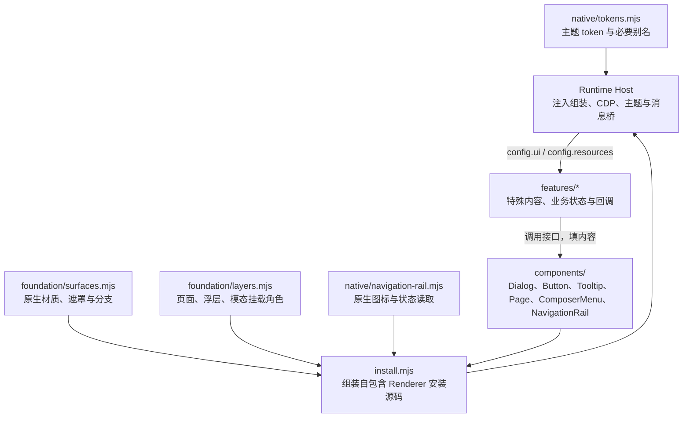

# UI 组件库架构

状态：2026-10-01 已迁移到独立 `@minecodex/ui` 私有 workspace。项目领域与层次原则见根 [ARCHITECTURE.md](../../ARCHITECTURE.md)，通用视觉见根 [DESIGN.md](../../DESIGN.md)，内部导航见根 [AGENTS.md](../../AGENTS.md)。

## 实际依赖



UI 不导入宿主或插件业务。安装源码在 Node 侧组装，Renderer 内执行时所有安装依赖已包含；插件继续消费 `config.ui`，不依赖 Node workspace 的模块解析。

## 当前目录

```text
packages/ui/
  package.json
  DESIGN.md
  ARCHITECTURE.md
  src/
    native/
      tokens.mjs                      # token 与别名的权威名单
      theme.mjs                       # 原生别名到项目变量、主题更新与卸载恢复
      navigation-rail.mjs              # 原生导航资源的 DOM 适配
      page.mjs                         # 原生无上下文侧栏页面壳与恢复
    foundation/
      surfaces.mjs                    # Dialog / Dropdown / Popover / Composer / Page 材质
      layers.mjs                      # 角色层级与挂载
    components/
      dialog.mjs                      # 标题、Close、自定义模态焦点契约
      button.mjs                      # 表单操作角色与操作区
      tooltip.mjs                     # 声明式 Tooltip 与清理
      navigation-rail.mjs             # 导航选中、恢复与图标展示
      page.mjs                        # 页面外壳
      composer-menu.mjs               # 输入框主体锚点与 zoom 定位
    install.mjs                       # 注入安装源码组装
  test/                               # 真实接口、源码自包含、架构依赖
```

Dropdown 与 Popover 当前只需要材质接口，直接由 `surfaces.mjs` 提供；没有为同一行转发创建独立组件文件。新增键盘列表或通用定位需求时，再根据真正的复用点拆出组件。窗口环境/共享锚点同样按实际需求组织，不建立空模块。

## 已完成的归属调整

- 旧 Runtime Host 的 design contract、Tooltip、弹窗与按钮实现已移入 UI，原位置文件已删除。
- 宿主 Page 外壳和 Prompts Page 使用同一页面角色；页层位于原生 Home hover sidebar 下方。
- Quick Prompts 使用 ComposerMenu；Prompts/Sites/模型菜单使用 Dropdown；会话详情和任务切换使用 Popover，显式区分材质。
- 会话指标归约及日志读取已移到 Session Status；云 Library 业务移到 Images，CDP 连接由宿主注入。
- Prompts 与 Sites 使用 `src/frontend/entry.mjs`、`styles.css`、`icons.json`，后端与领域规则独立组织。

## 后续扩展约束

只为实际使用的原生分支实现组件；根设计文档可以记录尚未使用的原生事实，不代表组件库已经提供相应 Interface。原生 form/catalog/系统 glass 等未被本项目需要的分支不预建空壳。

宿主继续维护 CDP、binding、安全边界、插件发现及 iframe 主题消息。Model Slider 的纯规则与专有原生控制器适配归插件，宿主只组装安装源码并调度刷新/卸载；Summary 的宿主 surface 接入仍留在宿主。

UI 安装源码接收宿主提供的 Codex 环境句柄和主题规范；图标读取复用共享 React 机制。主题解析属于 UI native Adapter，宿主只传递快照。独立组件测试可以提供明确的空主题上下文，不需要模拟真实 Codex。
