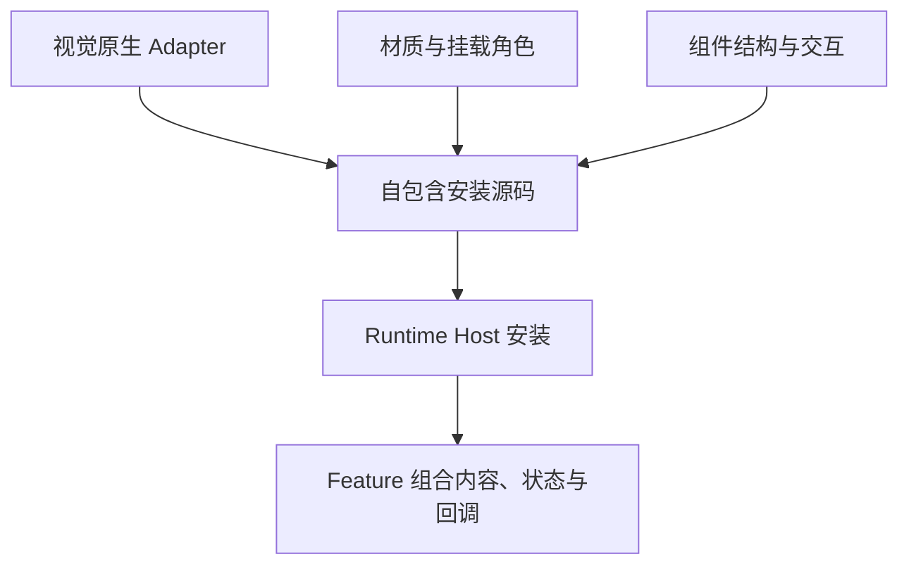

# UI 组件库架构

项目层次与接口原则见根 [ARCHITECTURE.md](../../ARCHITECTURE.md)，通用选型见根 [DESIGN.md](../../DESIGN.md)。本文件解释共享组件的组织与安装方式，具体接入见 [本级 DESIGN](DESIGN.md)。

## 复用单位

原生视觉 Adapter 解释主题、资源和状态；基础层提供材质与挂载角色；组件组合通用结构与交互。三者共同构成 UI 安装源码，功能消费内容接口，Runtime Host 负责安装与传递上下文。

材质与交互不必拥有相同拆分粒度。Dropdown / Popover 只需要材质时由 surface 接口提供；真正共用键盘列表或定位时再形成组件。原生分支已被记录，也不代表共享库应预建实现。

## 安装与环境

安装器在 Node 侧显式组装 Renderer 所需依赖，保证序列化函数不依赖 Node 闭包或 workspace 模块解析。改动组件依赖时核对自包含执行，不能把 Node 导入成功当作 Renderer 可用。

原生资源读取复用公共 Codex 环境机制；视觉协议和主题解析留在 UI native Adapter。宿主传递快照，功能接收公共句柄和自己的资源。独立组件验证可提供明确的空主题上下文，避免为结构与回调测试模拟整套 Codex。

组件文件与安装名单以当前源码为准。新增共享能力时验证实际复用点、安装组装和所属生命周期；新增功能不自动扩大共享层。
