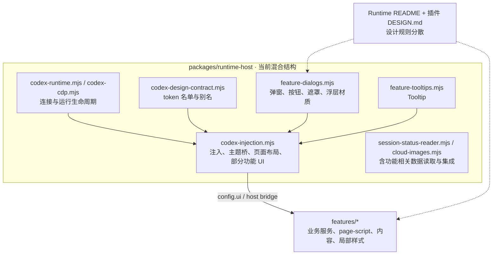
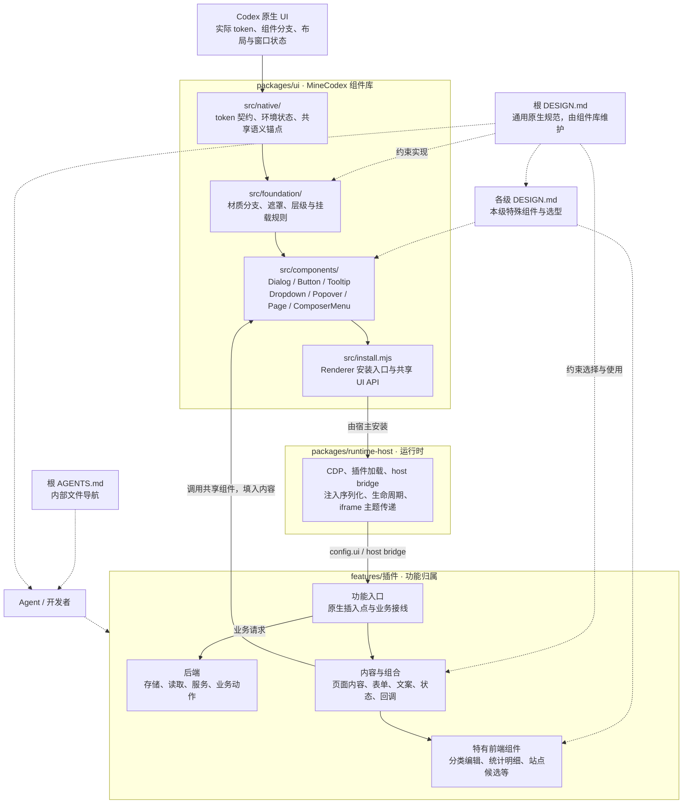

# 共享 UI 架构

状态：2026-10-01 的目标结构说明。当前只建立规范入口；下面标为目标的目录和模块尚未迁移或实现。

## 当前结构



共享组件已存在，但组件库边界没有独立表达：视觉规范散落在功能文档中，注入文件同时拥有运输机制、通用页面结构与部分功能渲染。

## 目标结构与依赖



图中实线是提供能力或调用关系，虚线是规范约束。UI 不读取插件数据库，不导入插件业务模块；Runtime Host 负责安装 UI，不维护组件视觉细节。

## 建议文件组织

```text
AGENTS.md                             # 内部规范与文件路由（已建立）
DESIGN.md                             # 全项目通用设计规范（已建立）
README.md                             # 对外产品、安装与使用说明
packages/
  ui/
    DESIGN.md                         # 组件库本级边界与接入约定（已建立）
    ARCHITECTURE.md                    # 当前/目标结构（已建立）
    src/                              # 以下为目标，尚未创建
      native/
        tokens.mjs                    # 原生 token 名单、必要别名
        environment.mjs               # 主题、zoom、窗口材质状态
        anchors.mjs                   # 跨插件共享的原生语义锚点
      foundation/
        surfaces.mjs                  # 按原生分支区分材质与 scrim
        layers.mjs                    # 页面/侧栏/浮层/模态的挂载契约
      components/
        dialog.mjs                    # 容器、标题、Close、操作区
        button.mjs                    # ghost / outline / solid 等
        tooltip.mjs                   # 共享 Tooltip 与无障碍关联
        dropdown.mjs                  # Dropdown 菜单
        popover.mjs                   # 轻量内容浮层
        page.mjs                      # 注入页面外壳
        composer-menu.mjs             # Composer 建议列表外壳
      install.mjs                     # Renderer 安装入口
    test/                             # 按实际迁移组件增加验证
  runtime-host/
    src/
      codex-runtime.mjs               # 连接与运行生命周期
      codex-cdp.mjs                   # CDP 运输
      codex-injection.mjs             # 注入组装与宿主接线，逐步收缩
      feature-registry.mjs            # 功能发现与声明
      host-actions.mjs                # 宿主动作与通信
features/
  <plugin>/
    codex-feature.json                # 功能声明
    DESIGN.md                         # 特有布局与共享组件选择
    src/
      backend/                        # 该功能的存储、读取、业务服务
      frontend/
        components/                   # 该功能特有组件
        content/                      # 页面、表单与浮层内容
        entry.mjs                     # UI 组合、原生插入点、业务接线
```

按模块实际规模采用目录，不要求简单插件创建空目录。上面列出的是职责边界和候选落点，不是一次性创建全部模块的清单。暂不引入新的前端框架、打包系统或插件协议。

## 已有文件的归属

| 现有位置／能力 | 目标归属 | 边界 |
| --- | --- | --- |
| `runtime-host/src/codex-design-contract.mjs` | UI `native/tokens.mjs` | token 名称及必要别名属于设计契约；iframe 发送流程仍属宿主 |
| `runtime-host/src/feature-dialogs.mjs` | UI `foundation/surfaces.mjs`、`components/dialog.mjs`、`components/button.mjs` | 材质、结构、按钮独立维护，不在每个插件复制 |
| `runtime-host/src/feature-tooltips.mjs` | UI `components/tooltip.mjs` | 声明式标记、hover/focus、aria 关联、卸载清理 |
| `codex-injection.mjs` 中的共享页面外壳／布局 | UI Page 与共享层级能力 | CDP、host binding、安全边界、消息桥仍留宿主 |
| `features/notes/src/quick-prompts-page.mjs` | Prompts 前端内容、特有组件与入口 | 提示词表单、分类、图标选择、排序仍属功能 |
| `features/sites/src/sites-page.mjs` | Sites 前端内容、特有组件与入口 | 项目候选、站点表单、列表增强仍属功能 |
| 宿主中的会话读取等功能实现 | 按真实调用边界逐项归还相应插件 | 例如会话统计解析属于 Session Status；跨功能集成桥不能只按文件名搬动 |

已有 `features/images/web` 的 iframe 页面需要继续获得 token；不要把它当作已能直接访问 Renderer 的 `config.ui`。直接注入与 iframe 的运行环境差异由公共组件的接入方式和宿主桥处理，插件不应各自发明主题规则。

## 调用与运行边界

- UI 对外提供统一能力；插件传内容、业务状态和回调。通用结构与默认交互由组件库负责，功能数据与具体业务生命周期仍属插件。
- 当前 page-script 通过 `config.ui` 获得共享能力，迁移时优先保持这个接入契约。
- Renderer 脚本经函数序列化注入，必须自包含。不能把含模块闭包依赖的函数直接 `.toString()` 后期待其 imports 存在。宿主仍负责组装可注入源码。
- UI 的 DOM/CSS 代码不依赖 Node、CDP 客户端或插件服务；宿主的通信与安全代码不依赖某个插件的页面结构。
- 一个规则只维护一个权威来源：通用规则在根 DESIGN.md，功能差异在插件 DESIGN.md，运行方式在 Runtime Host README。

## 迁移顺序

1. 建立共享规范与文档入口，确认职责及目标结构（本次）。
2. 迁移 token、Tooltip 与已有弹窗/按钮代码，保持注入契约；同步导入路径、相关验证及发布文件名单。
3. 将现有单一浮层材质拆为实际需要的原生组件分支，再接入现有插件；删除重复规则。
4. 按功能边界逐项拆出宿主和插件中的混合职责，避免一次性重写所有插件。

每步交付应可检查：规范入口明确、组件只有一份实现、依赖方向正确、插件行为保留、相关文档与发布内容同步。
