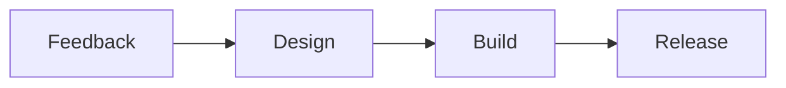

# Release Planning Guide

A short guide for planning the next release of a desktop app.

## Goals

- [x] Collect feedback from the beta channel
- [x] Group requests by user task
- [ ] Draft the release notes
- [ ] Schedule the accessibility review

## Timeline

| Phase | Owner | Start | End | Scope | Status | Notes |
| --- | --- | --- | --- | --- | --- | --- |
| Discovery | Design | Nov 3 | Nov 7 | Interviews and usage review | Done | Twelve sessions with daily users |
| Build | Engineering | Nov 10 | Nov 21 | Settings, shortcuts and themes | In progress | Shortcuts land behind a flag first |
| Review | QA | Nov 24 | Nov 28 | Regression and accessibility pass | Planned | Covers light, dark and high contrast |
| Release | Product | Dec 1 | Dec 2 | Staged rollout to all channels | Planned | Start with 10% of the stable channel |

## Release Flow



## Checklist Script

```bash
npm test
npm run check
npm run pack:audit
```

## Open Questions

1. Should shortcuts be configurable in the first release?
2. Do we need a migration note for existing themes?

## Next Steps

Share this guide with the team and confirm owners before Friday.
